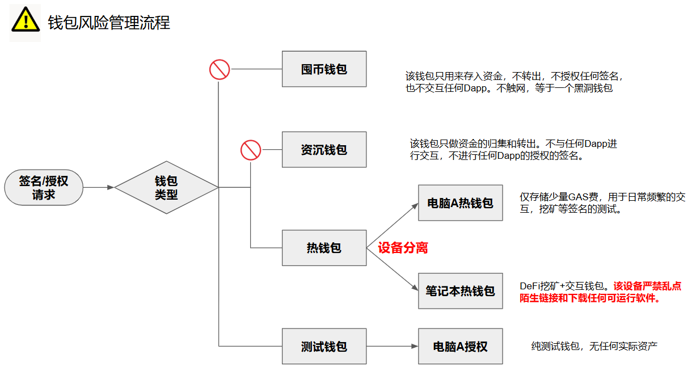

# 加密钱包安全架构

请牢记：安全永无止境！

经过很长一段时间的学习和实践，目前总结出了一套适用于自己的加密钱包安全架构，

1. 资产分层和风险隔离
2. 助记词的生成和保管
3. 签名

## 资产分层和风险隔离

加密行业的资产类型众多：原生币、稳定币、DeFi、NFT、跨链资产、流动性池份额等。它们的风险特征不同，不能放在同一个安全层级里。分层的意义在于任何一层被攻破，损失都被限制在该层内。不要把“一个钱包管所有资产”当成默认做法。

###一：插件钱包

主要是参与多类网页的交互，如与新协议、新链、不明合约、空投交互等，包括 Mint NFT，参与DeFi，玩GameFi游戏，以及打新等。这一层应该使用独立的钱包和独立的少量资金，假设它随时可能归零。

资金额度$200以内

**授权管理** 定期使用工具如Etherscan或Revoke.cash查看并清理DApp的授权权限。

###二：手机钱包/桌面钱包

接收和发送资产给插件钱包用于日常的交互，采用空气签的方式实现离线签名，确保私钥不触网。

资产额度 $2000 以内

###三：硬件钱包

只接收资金，不与任何钱包交互，优先使用开源、经过审计、支持离线签名的硬件钱包。私钥全程不接触网络。如果是存储的是BTC，建议使用BTC-Only的硬件钱包。

资产额度 $50000 以内

###四：纸钱包/脑钱包

只接收资金，不与任何钱包交互。助记词不放入任何设备中，只存在于脑中或者记录的纸上。

资产额度 $100,000 以上

## 助记词的生成和保管

第二层：私钥与助记词管理
生成环节：助记词必须在离线、可信、熵源可靠的环境中生成。硬件钱包的专用安全元件和真随机数生成器比软件环境更可靠。软件生成只适合测试或小额。

备份环节：助记词绝不数字化——不拍照、不存云盘、不发邮件、不存密码管理器。使用金属助记词板做物理备份，防火防水。至少两份，地理上分开存放。助记词和硬件设备不要放在同一个地方。

Passphrase 的额外规则：如果使用 BIP-39 Passphrase，它必须与助记词分开备份。两者同时泄露，Passphrase 就失去了保护意义。Passphrase 需要你单独记忆或存放在不同地点。

多签与 MPC 的额外规则：多签的 Descriptor 或 MPC 的分片配置，必须与对应的助记词/分片配对存放。每个存放点构成一个完整的恢复单元。不要把所有分片交给同一个人或同一家机构。

🖥️ 第三层：运行环境与操作安全

专用设备：理想情况下，用一台专用电脑或手机处理加密资产操作，不用于日常上网、邮件、社交。如果做不到，至少确保操作设备上没有来路不明的软件，浏览器不装无关扩展。浏览器扩展钱包的风险尤其高——一个恶意扩展可能影响同一浏览器环境下的所有钱包。

自主验证：尽可能使用自己的全节点或可信的轻客户端验证余额和交易，不把地址查询完全交给第三方 API。对于以太坊等账户模型链，至少使用多个独立的 RPC 端点交叉验证关键交易。

交易前核对：每一笔交易，在签名设备的屏幕上逐字核对收款地址、金额、链 ID、合约交互内容。不要只依赖电脑屏幕。这是防止“盲签”和“地址替换”的最后一道防线。对于 DeFi 交互，还要核对授权额度和合约地址，避免无限授权给恶意合约。

设备来源：硬件钱包直接从制造商官方渠道购买。到手后验证包装完整性和固件签名。不要购买二手硬件钱包，不要使用来历不明的预配置设备。

🌐 第四层：链上与交互风险控制

这是加密行业比单纯持币更复杂的部分。

授权管理：定期检查并撤销不必要的代币授权。无限授权给不熟悉的合约，是 DeFi 用户最常见的资产损失原因之一。使用链上工具查看当前授权状态，只保留必要的、额度合理的授权。

合约交互审查：在签署任何合约交互前，确认合约地址是官方部署的，理解这笔交易会做什么。不要因为“看起来像官方界面”就盲目签名。钓鱼网站可以完美复制前端，但合约地址不会骗人。

跨链桥风险：跨链桥是历史漏洞高发区。只使用经过时间检验、审计充分、有漏洞赏金计划的桥。跨链时先小额测试，不要一次性转移大额资产。

MEV 与抢跑：在以太坊等链上，大额交易可能被 MEV 机器人抢跑。使用隐私 RPC 或交易中继服务，可以减少交易在内存池中暴露的时间。

地址投毒与零值转账：攻击者会向你的地址发送零值或小额交易，伪造一个与你常用地址相似的地址，诱导你从历史记录中复制错误地址。不要从交易历史中复制地址，始终从可信来源或地址簿中获取收款地址。

链上钱包被盗的事件越来越多，尤其是各种社交软件上充斥着大量的诈骗信息，很不幸，我也曾中招了不止一次。交了学费，就该学会一些防盗的经验。除了要学会分辨哪些是骗局外，自己还应该做好风险的隔离。人总是会犯错，如果有一套系统的风险措施，就能大概率会隔离掉大部分的骗局。即使被骗，也可以确保自己的损失是最小的。

那么首先要做的就是资金的隔离。也就是我们常常听到的那句话：

不要把鸡蛋放在一个篮子里

所以，不同用处的资金应该使用不同的钱包。当然，这里也要做好钱包的备份，毕竟因为忘记助记词而丢失资金的例子数不胜数。在学习了HD钱包的相关知识后，有一点需要补充下，那就是不用每一类的钱包都备份一套助记词，可以在一套助记词下生成多个账户的钱包，不同的钱包对应不同应用场景。

钱包风险管理流程

## 钱包分类：

我目前有4类钱包：囤币钱包，沉淀资金钱包，交互钱包，测试钱包。

### 囤币钱包 - 冷钱包

要求高安全等级，我采用的是冷钱包的方式。用Onekey硬件钱包在不触网的前提下生成，或者通过不用的智能手机，在不触网的前提下安装钱包并生成助记词。使用钱包来完成以上工作就默认了你完全信任钱包的开放商，而更安全的做法是自己手搓一套助记词出来，这样可以确保真正的随机。

该钱包只用来存入资金，不转出，不授权任何签名，也不交互任何Dapp。可以说**这类钱包不触网**，对我来说就是一个黑洞钱包。

## 资产沉淀钱包

要求高安全等级，我采用的是硬件钱包的方式。由Onekey硬件钱包生成。

该钱包**只做资金的存入，归集以及转出。不与任何Dapp进行交互，不进行任何Dapp的授权的签名。**

## 挖矿/热钱包 - 3级管控

1. 500U以内：Mac热钱包
2. 500U-5,000U：Mac+Onekey硬件钱包
3. 5000U：Windows笔记本电脑+Onekey硬件钱包

### 500 USDC以内，使用Mac上的热钱包

由Matemask，OKX钱包，Binance Wallet等热门的钱包生成。该钱包主要用于DeFi挖矿，提供流动性，Lending，Staking，或者与Dapp授权签名和交互等。

### 500-5000 USDC，Mac + Onekey硬件钱包

资产超过100 USDC就应该使用硬件钱包，这样可以显著提高安全等级。另外，考虑到使用的方便性，所以放在Mac这个常用电脑上，兼具安全和便利性。

### 5000 USDC以上，Windows+Onekey硬件钱包

Windows笔记本电脑为不常用的电脑，常年离线且不开机，该笔记本电脑不会点陌生链接，任何链接都经过了Mac的验证，且它也不下载任何可运行的软件。所以它可用于大额资金交互/质押任务，只有涉及到大额资金才启用Windows笔记本电脑，并且要配合Onekey硬件钱包使用，可极大提高安全性。

---

## 测试钱包

要求低安全等级，该类钱包主要用于项目测试，建议存放少量GAS费即可。任何需要签名/授权都使用该钱包。

主要用Rabby Wallet来创建

最后，还是请牢记：

**安全永无止境，要持续学习最新的加密钱包安全实践，避免因信息滞后而中招！**

